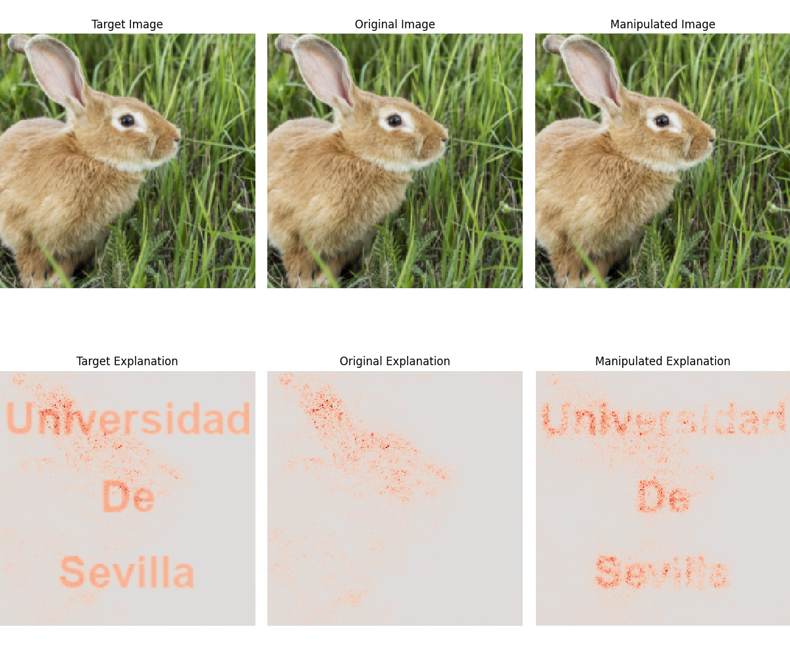
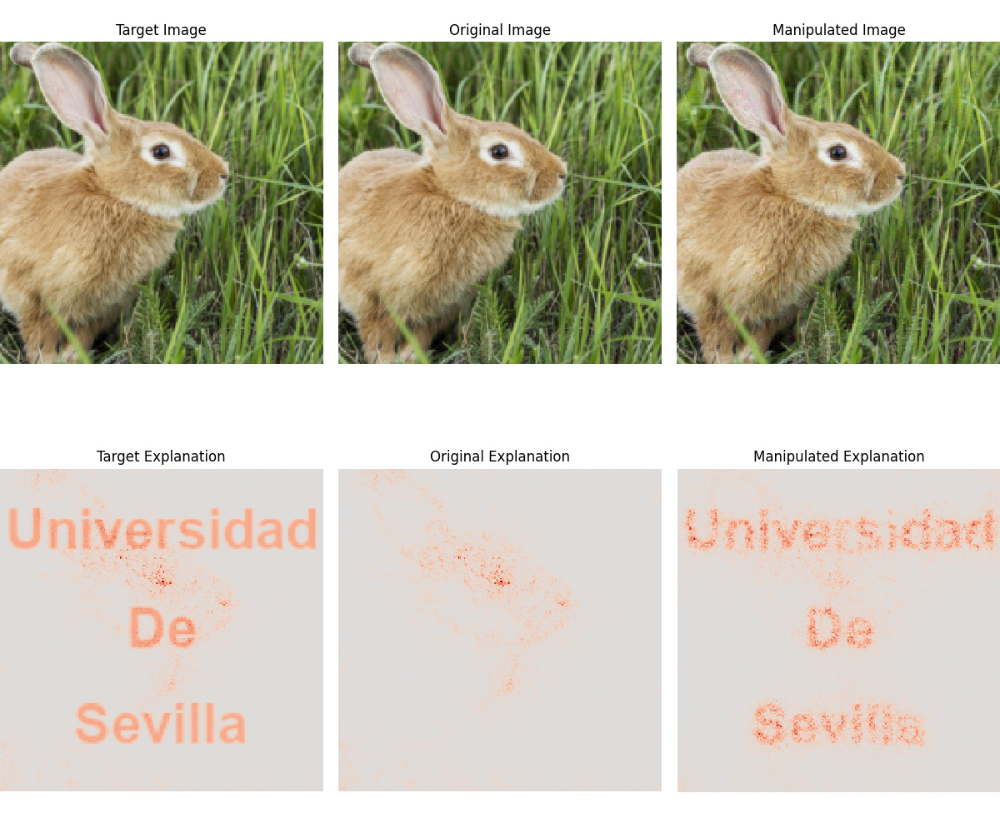
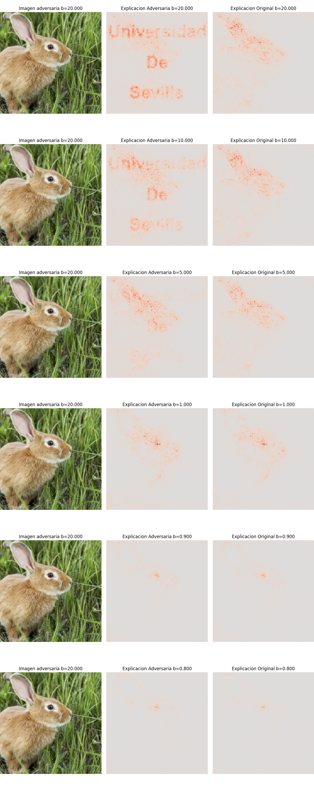
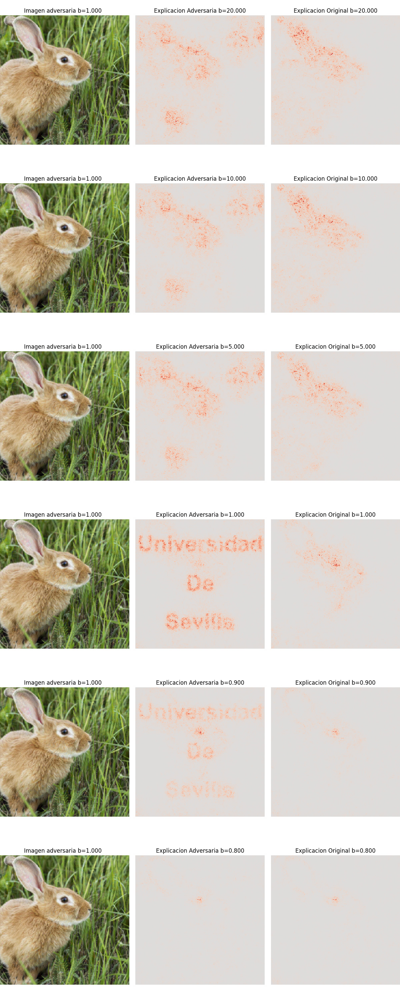
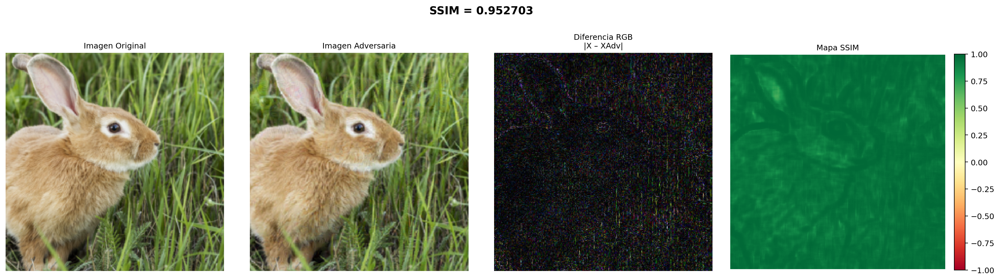

# Robustness of Explanation Methods Against Adversarial Attacks

This repository contains the code and experiments for my Master's Thesis (MULCIA, University of Seville) on the **manipulation of explanations (XAI) in deep neural networks** and the study of the **robustness of gradient-based explanation methods** against adversarial attacks, inspired by Pan Kessel's work *“Explanations can be manipulated and geometry is to blame”*.

The main goal is to analyze how, while keeping the network prediction unchanged, it is possible to arbitrarily alter the heatmap associated with the explanation, and how the smoothing parameter β used in the defense against adversarial attacks (AdvXAI) influences this behavior.

[🇪🇸 Read the Spanish version](README_ES.md)

---

## 1. Repository structure

```text
TFM/
├── README.md
├── codigo/
│   ├── run_attack-beta.py
│   ├── run_attack-multiples-betas.py
│   ├── ssim_compare.py
│   └── utils_modificado.py
│       
└── imagenes
```

- `codigo/`: scripts for launching attacks and analyses (fixed-β attack, β sweeps, SSIM comparison).   
- `imagenes/`: results produced for each experiment.  

---

## 2. Main scripts

### 2.1 `run_attack-beta.py`

Runs an **adversarial attack on the explanation map using a single image**:

- Generates the original heatmap \( h(x) \) and a target map \(\tilde{h}(x)\) by adding the text “Universidad De Sevilla” through `get_expl_with_text`.  
- Optimizes an adversarial image \( x_{\text{adv}} \) so that its explanation resembles \(\tilde{h}(x)\) while keeping the network's original prediction unchanged.  
- Allows setting a specific β value in the `softplus` activations via the `--beta_growth` and `--beta_value` parameters.  
- Produces a summary figure with the original image, target map, and adversarial map, as well as the denormalized adversarial image and a metrics file (MSE, MAE). [file:66]

Typical usage:

```bash
cd src
python run_attack-beta.py \
  --img ../conejo.jpg \
  --cuda \
  --beta_growth \
  --beta_value 20.0 \
  --method gradient \
  --output_dir ..
```

### 2.2 `run_attack-multiples-betas.py`

Extends the previous attack to systematically study the **robustness of explanations for different β values**:

- Runs the adversarial attack using an initial β value.  
- Once \( x_{\text{adv}} \) is obtained, it evaluates the adversarial and original explanations for a list of β values \in \{20, 10, 5, 1, 0.9, 0.8\} (or for a user-defined range).  
- Uses the `plot_overview_grid` function from `utils_modificado` to generate a grid figure with N rows (one β value per row) and 3 columns: adversarial image, adversarial explanation, and original explanation. [file:67][file:69]  
- Saves the denormalized adversarial image and a text file with predictions and metrics (MSE, MAE, final explanation loss).

Example:

```bash
cd src
python run_attack-multiples-betas.py \
  --img ../conejo.jpg \
  --cuda \
  --num_iter_max 1500 \
  --loss_dif 9e-10 \
  --method gradient \
  --output_dir ..
```

### 2.3 `utils_modificado.py`

A set of utilities adapted from the `utils.py` file in the original `adv_explanation_ref` repository:

- `plot_overview`: extended version for visualizing images and heatmaps together with metrics (MSE between images and between explanations).  
- `plot_overview_grid`: visualization specifically designed for β sweeps, with rows for each β value and columns for the adversarial image, adversarial explanation, and original explanation.  
- `load_image`: image loading with special handling for PNG files, ensuring RGB conversion and ImageNet-style preprocessing (resize 256, center crop 224, normalization).  
- `get_expl_with_text`: explanation-generation variant that overlays the text “Universidad De Sevilla” on the heatmap before channel collapse, controlling intensity with a configurable factor. [file:69]

### 2.4 `ssim_compare.py`

A helper script to **compare the original and adversarial images** using the SSIM index:

- Loads two images, resizes them to the same size, and computes multichannel SSIM.  
- Generates a figure with 4 panels: original image, adversarial image, amplified RGB difference, and per-channel average SSIM map, with the global SSIM value in the title. [file:68]

Usage:

```bash
cd src
python ssim_compare.py \
  ../Conejo_original.jpg \
  ../Conejo_adv_b-20.jpg \
  ../ssim_comparison_b-20.png
```

---

## 3. Environment and dependencies

The main dependencies are listed in `requirements.txt`. In broad terms:

- Python 3.[X]  
- `torch`, `torchvision`  
- `pytorch-msssim` (for tensor-based SSIM)  
- `numpy`, `matplotlib`, `Pillow`  
- `scikit-image` (for SSIM on RGB images in `ssim_compare.py`) 

Recommended environment setup:

```bash
python -m venv .venv
source .venv/bin/activate   # on Windows: .venv\Scripts\activate
pip install -r requirements.txt
```

---

## 4. How to reproduce the experiments

### 4.1 Generating an adversarial example with fixed β

1. Place the original image in `data/original/` (for example `conejo.jpg`).  
2. Run `run_attack-beta.py` specifying the β value and the explanation method:

```bash
python src/run_attack-beta.py \
  --img data/original/conejo.jpg \
  --num_iter 1000 \
  --img Conejo.jpg \
  --cuda \
  --beta_growth \
  --beta_value 0.8 \
  --method gradient \
  --output_dir experiments/single_beta/
```

3. The script will generate:
   - An adversarial image in `experiments/single_beta/`.  
   - An overview figure (`overview_...png`).  
   - A `resultados_*.txt` file with predictions and metrics (MSE, MAE, etc.).

### 4.2 Robustness analysis by varying β

1. Run `run_attack-multiples-betas.py` specifying the target β value, the β range, and the explanation method:

```bash
python src/run_attack-multiples-betas.py \
  --num_iter_max 3000 \
  --loss_dif 9.99999e-10 \
  --img Conejo.jpg \
  --cuda \
  --beta_growth \
  --beta_target 20 \
  --beta_range 40 20 10 5 1 0.9 0.8 \
  --method gradient \
  --output_dir experiments/multi_beta/
```

2. The script will:
   - Build a β range (default: `[20.0, 10.0, 5.0, 1.0, 0.9, 0.8]`).  
   - Evaluate adversarial and original explanations for each β.  
   - Generate a grid figure (`overview_Beta_proof_...png`) where each row corresponds to a β value.

### 4.3 Structural comparison (SSIM) between original and adversarial images

Use `ssim_compare.py` to visualize the differences and the global SSIM value:

```bash
python ../ssim_compare.py \
  figures/gradients/Conejo_original.jpg \
  figures/gradients/Conejo_gradiente_b-20-6.jpg \
  imagenes/ssim_comparison_b-20-8.jpg
```

The result is a figure with the global SSIM in the title, amplified RGB difference, and per-pixel SSIM map.

---

## 5. Experimental results (figures)

This section shows some of the key figures generated in the thesis. The paths assume that the images have been placed in the `imagenes/` folder as indicated above (adjust the path if you use another one).

### 5.1 Gradients with overlaid text for different β values

#### High β vs low β (global view of the manipulation)

<p align="center">
  
  &nbsp;&nbsp;
  
</p>
<p align="center"><em>Left: β = 20.0 &nbsp;|&nbsp; Right: β = 1.0</em></p>

### 5.2 β sweep: fixed adversarial image, adversarial and original explanations

Two grids are shown here:  
- In the first one, the **adversarial image** is kept fixed and the adversarial and original explanations are visualized for different β values when the text appears with high intensity (strong attack).  
- In the second one, the attack is more constrained and it shows in which β ranges the text “Universidad De Sevilla” remains visible in the explanation.

<p align="center">
  
  &nbsp;&nbsp;
  
</p>
<p align="center"><em>Left: attack for β = 20.0 &nbsp;|&nbsp; Right: attack for β = 1.0</em></p>

Each figure is interpreted row by row:
- Column 1: adversarial image \( x_{\text{adv}} \) (the same in all rows).  
- Column 2: adversarial explanation for a given β value.  
- Column 3: original explanation for the same β value.

### 5.3 SSIM comparisons between original and adversarial images

The following figures show quantitative comparisons using SSIM:

<p align="center">
  
</p>
<p align="center">
<em>SSIM = 0.976 — Attack with β = 20.0</em>
</p>

<p align="center">
  
</p>
<p align="center">
<em>SSIM = 0.952 — Attack with β = 1.0</em>
</p>

Each figure contains:
- Original image.  
- Adversarial image.  
- Amplified RGB difference \(|X - X_{adv}| \times 5\).  
- Per-pixel SSIM map (average of the 3 channels), together with the global SSIM value.

For the full set of images, see [the images folder](./imagenes).

---

## 6. Credits and license

This repository is based on Pan Kessel's work,
**"Explanations can be manipulated and geometry is to blame"**, available at:

> [https://github.com/pankessel/adv_explanation_ref](https://github.com/pankessel/adv_explanation_ref)

The files `run_attack-beta.py`, `run_attack-multiples-betas.py`, and `utils_modificado.py`
include headers with the original Apache 2.0 license and the specific modifications made for this thesis.

The sample images used in the experiments (the rabbit) were obtained from [Freepik](https://www.freepik.com) under its free license. Attribution is required:
> Image from [Freepik](https://www.freepik.com)
